[盲目之龍完整攻略](/任務攻略/魔力任務/盲目之龍) · [三等勳章完整攻略](/任務攻略/魔力任務/三等勳章)

把兩個任務的雷村行程合在一起：**第一次同時接任，第二次製藥兼交觸媒，第三次領三勳，再去岬之神殿完成盲龍**。艾爾巴與蘭國都可照此順序。

這是依既有任務流程與地圖安排的建議路線，尚未整趟合解實跑；不是已量測的最短走法。

## 出發準備

- 三勳：持有**艾爾巴或蘭國第四等勳章**稱號。
- 盲龍：已完成沉默之龍、有**龍之拯救者**稱號；每人帶**紅龍諾利的鱗片**與購買信徒證明的 **2,000G**。
- 以**哥拉爾為登出點、已開米諾基亞村傳送點**安排。尚未開點，先走[伊利斯礦山到米村](/地圖/庫魯克斯島/米諾基亞村)。
- 麥尼村醫院沒有 NPC，無法補給。進長迷宮前，先在哥拉爾或雷村補好血魔與裝備耐久。

## 行程總覽

| 順序 | 移動與處理 | 離開前完成 |
| --- | --- | --- |
| 1 | 傳米村、步行雷村；神殿同接兩任務 | 尋藥委託、信徒證明、心腹委託 |
| 2 | 雷村出鎮先跑炎洞；再登出回哥拉爾 | 災禍之水 |
| 3 | 哥拉爾出發跑水洞；回城補給，再過橋跑地洞、麥尼村 | 懲戒之石、真理之枝、麥麥草；救月心並在民家再談一次 |
| 4 | 傳米村、步行雷村；送藥取藥，接著交三種觸媒、走回憶與冥府 | 第二份特效藥；與豪爾交談回雷村 |
| 5 | 登出回哥拉爾，再去麥尼村送藥、打實朝 | 天帝之証；戰後再找月心 |
| 6 | 傳米村、步行雷村；打森國、交證領三勳 | 每人各自領到第三等勳章 |
| 7 | 雷村補給後前往岬之神殿，找艾汀 | 北國行者、巨龍艾汀的鱗片 |

**省在共用雷村行程，不是省掉三勳的送藥往返**。麥尼村必須去兩次；第一次拿草後，仍要回雷村製藥，才能第二次進洞找實朝。

三洞可任選順序。這裡先排雷村一側的炎洞，再把地洞與麥尼村安排在同一趟過橋行程；水洞另跑一段，不把島上隔山的位置當成直線捷徑。岬之神殿留到最後，避免盲龍先做完後又回頭補三勳。

展開島上洞窟位置、米村到雷村及哥拉爾到麥尼村路線

洞窟圖：1 雷村、2 水洞、3 炎洞、4 地洞、5 岬之神殿；數字是地點編號，不是本篇行程順序。

<a href="/img/pages/任務攻略/魔力任務/盲目之龍/island.webp">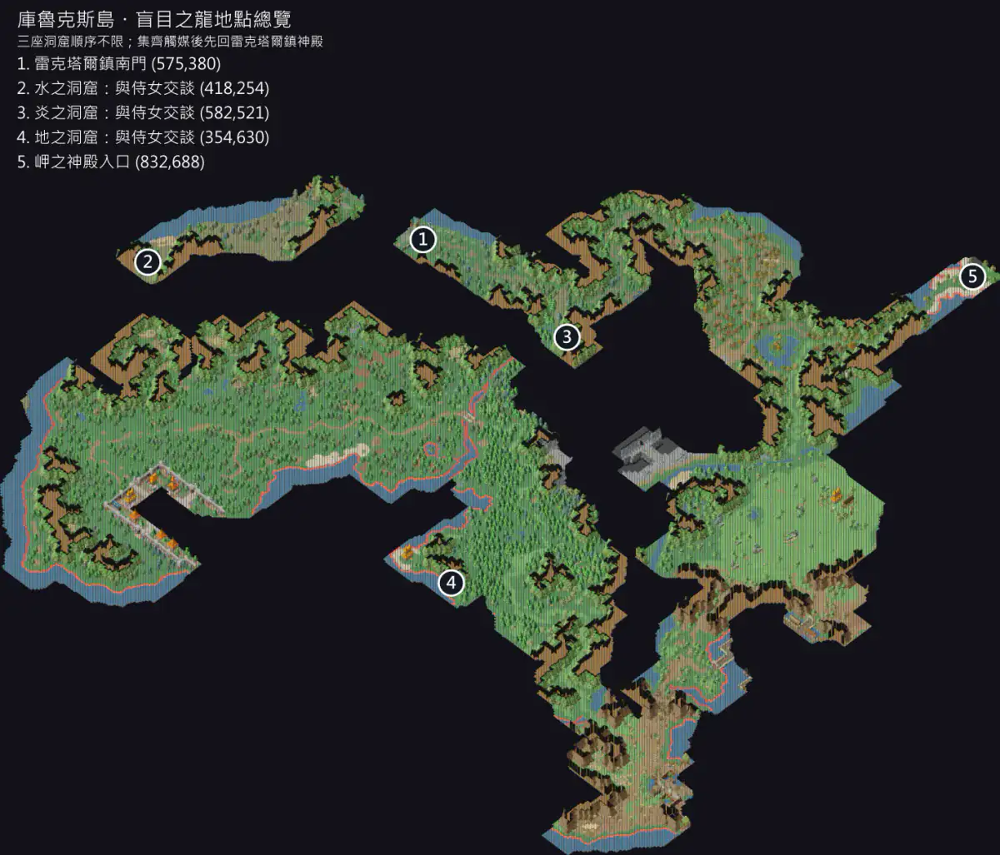</a>

去雷村：米村西側 `(17,84)` 出村，沿島上道路往北到雷村南門 `(575,379)`。

<a href="/img/maps/庫魯克斯島/mino-to-lei.webp">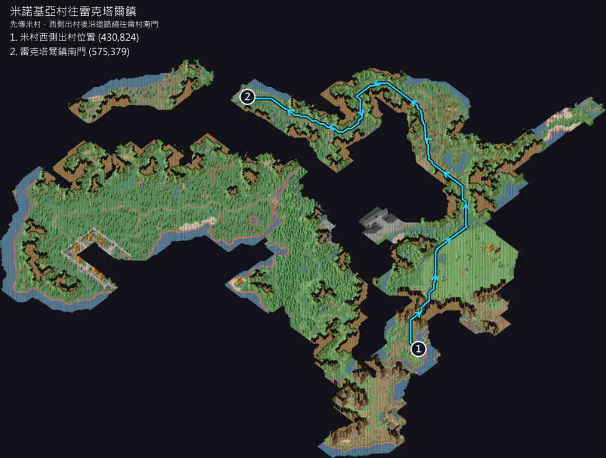</a>

去麥尼村：哥拉爾東門出城，找橋頭士兵米希爾 `(477,526)` 過橋，走到花圃內的村口 `(428,682)`。

<a href="/img/maps/庫魯克斯島/mai-ni-arrival.webp">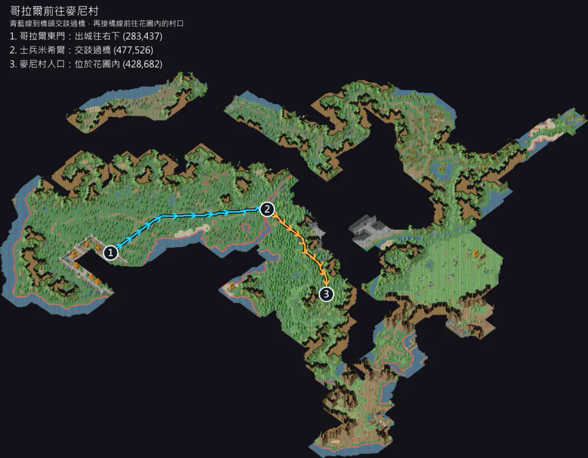</a>

## 1. 第一次雷村：捐獻受款處一次辦兩件事

從米村步行到[雷克塔爾鎮](/地圖/庫魯克斯島/雷克塔爾鎮)，醫院 `(77,93)` 補給後，進神殿 `(105,22)`。

玄關從 `(25,20)` 往左側 `(1,7)` 進捐獻受款處，換圖後人在 `(28,25)` 附近：

1. **盲龍**：找收款員 `(22,25)`，選「是 → 否 → 確定」，每人花 2,000G 拿信徒證明。
2. **三勳**：找護士千千 `(8,28)`，選「是」進醫務室，與醫師瑟拉維 `(16,13)` 交談接下尋藥委託，傳回捐獻受款處。
3. **盲龍**：回玄關走右側 `(48,7)` 房間，從 `(10,9)` 上樓，找謁見之間的聖女心腹 `(19,10)`，選「是」接下三種觸媒委託。

<a href="/img/pages/任務攻略/魔力任務/盲目之龍/vestibule.webp">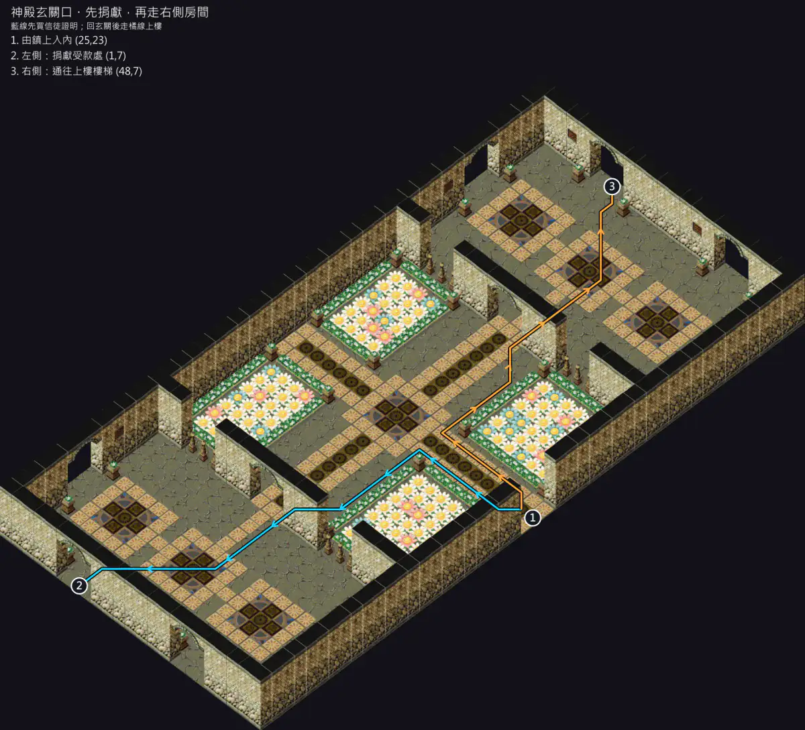</a>

展開護士、收款員與上樓路線

<a href="/img/pages/任務攻略/魔力任務/三等勳章/43753.webp">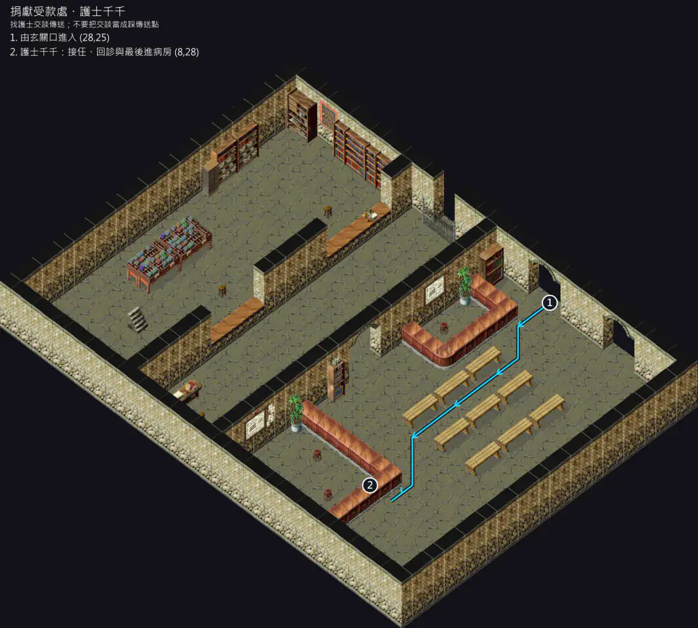</a>

<a href="/img/pages/任務攻略/魔力任務/盲目之龍/donation.webp">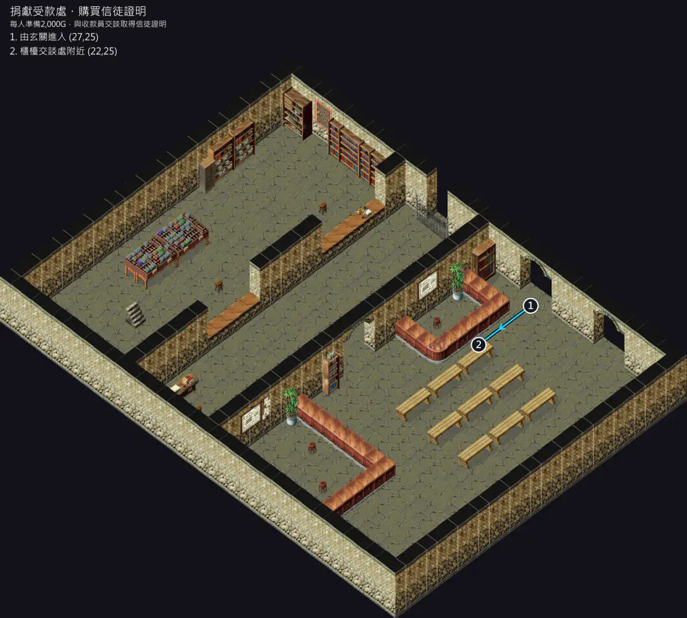</a>

<a href="/img/pages/任務攻略/魔力任務/盲目之龍/temple-up-linked.webp">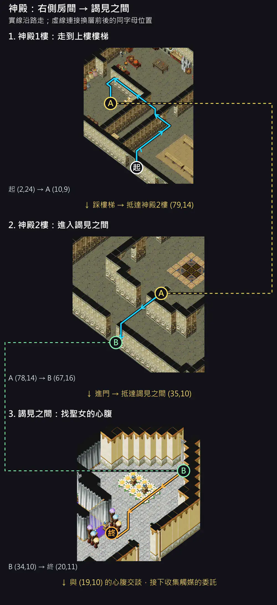</a>

## 2. 炎洞 → 水洞 → 地洞，最後接麥尼村

下圖對照三座洞窟與村莊的相對位置：**1 炎洞、2 水洞、3 地洞、4 麥尼村**；5 是雷村、6 是哥拉爾東門、7 是過橋處。炎洞後登出回哥拉爾，不是直接從炎洞穿山走到水洞。

<a href="/img/maps/庫魯克斯島/blind-medal3-overview.webp">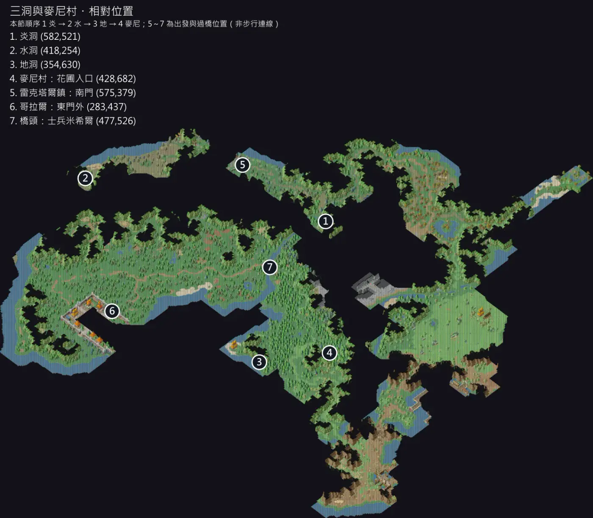</a>

**先離開雷村跑炎洞 `(582,521)`**。取得災禍之水後，登出回哥拉爾補給，再往水洞 `(418,254)`。水洞拿到懲戒之石後，回哥拉爾整備下一段。

接著從哥拉爾東門出城，找士兵米希爾 `(477,526)` 過橋，先往地洞 `(354,630)` 取得真理之枝，再前往麥尼村 `(428,682)`。地洞與村莊之間沿島上道路走，兩處不是直接相通的洞窟。

| 洞窟 | 水晶 | 戰後取物位置 | 帶走 |
| --- | --- | --- | --- |
| 炎 `(582,521)` | 純水 | 災禍之間石碑 `(15,17)` | 災禍之水 |
| 水 `(418,254)` | 純地 | 懲戒之間石頭 `(20,9)` | 懲戒之石 |
| 地 `(354,630)` | 純風 | 真理之間樹木 `(19,10)` | 真理之枝 |

三洞途中找樓梯，最後一層走傳送石。頭目房找受詛咒者 `(27,11)`；三場都是 **Lv90 受詛咒者 ×1＋Lv75 小兵 ×4，先清小兵再打王**。沿途一般遇敵建議逃跑，避免反覆召喚拖時間。戰後還要調查物件，每人拿到觸媒才離開。

展開炎、水、地三洞的頭目房與取物圖

<a href="/img/pages/任務攻略/魔力任務/盲目之龍/fire-linked.webp">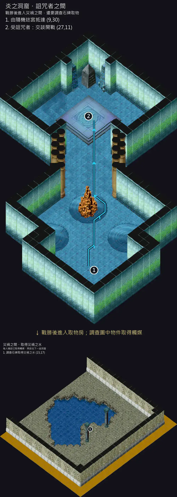</a>

<a href="/img/pages/任務攻略/魔力任務/盲目之龍/water-linked.webp">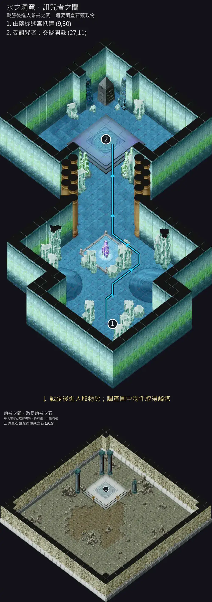</a>

<a href="/img/pages/任務攻略/魔力任務/盲目之龍/earth-linked.webp">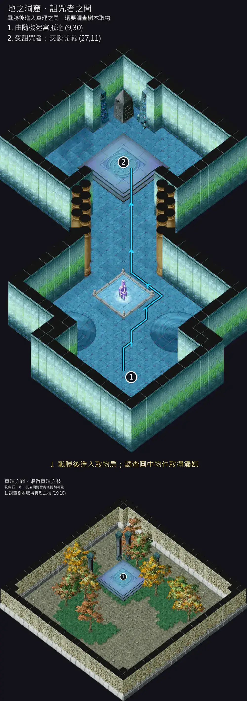</a>

## 3. 第一次麥尼村：拿草、救月心

進村找獵人小麥 `(47,55)`，選「是」進洞。先到 `(11,5)` 每人拿**麥麥草**，再到 `(40,39)` 找月心，傳到民家後再與月心 `(6,7)` 交談一次。

這趟帶著**麥麥草＋石、水、枝三種觸媒**回雷村。登出回哥拉爾，傳米村後步行前往；不用為交盲龍觸媒另外再跑一趟。

## 4. 第二次雷村：製藥、取第二份藥，再交觸媒

### 先辦三勳送藥

1. 神殿捐獻受款處找護士，進醫務室把**麥麥草**交給醫師，拿到第一份**特效藥**並傳入病房。
2. 與席琳 `(6,9)` 交談，把第一份藥交給她。
3. 回去找醫師，傳至保管庫入口；與守衛交談選「是」，走通路到 `(58,14)` 進保管庫。
4. 調查藥棚 `(10,12)`，每人拿第二份**特效藥**。這份是月心的，先留在身上。

展開保管庫領藥路線

<a href="/img/pages/任務攻略/魔力任務/三等勳章/storage-linked.webp">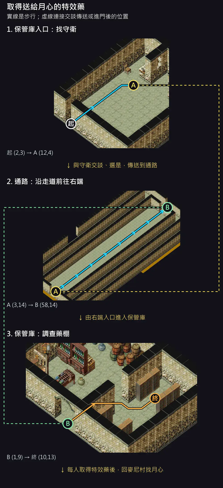</a>

### 留在雷村，接著辦盲龍

回神殿謁見之間找心腹 `(19,10)` 選「是」，通過內側 `(19,1)`，經聖女房間、神殿1樓內側到地下聖堂，找瑪哈 `(14,24)` 交出**石、水、枝**。

接著依序交談：旅館男子 `(13,5)` → 換景後男子 `(13,13)` 或女子 `(12,12)` → 黑之宮殿女子 `(30,20)` → 冥府之道豪爾 `(36,9)`。最後由豪爾**傳回雷村 `(72,71)`**；無名者不是必打戰。

沉默之龍歸途打過白銀騎士團者，這裡取得**通行許可證**，可免打後面的薇絲。沒有許可證仍可完成盲龍，但要打薇絲。

展開交觸媒、過去場景與冥府之道地圖

<a href="/img/pages/任務攻略/魔力任務/盲目之龍/sanctuary-linked.webp">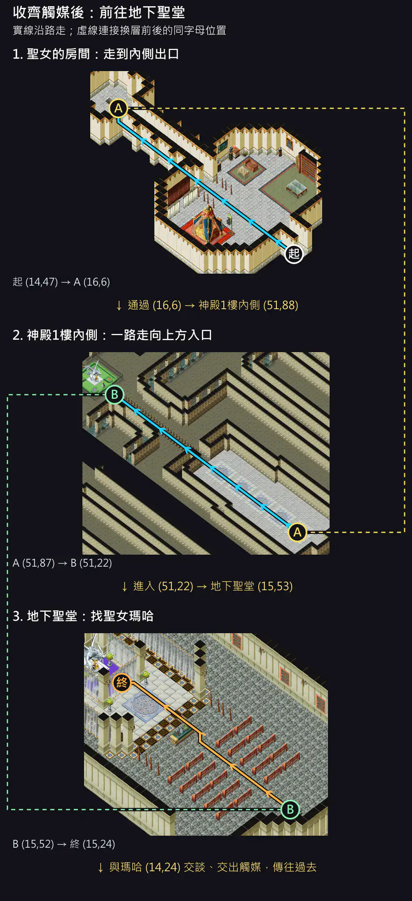</a>

<a href="/img/pages/任務攻略/魔力任務/盲目之龍/past-linked.webp">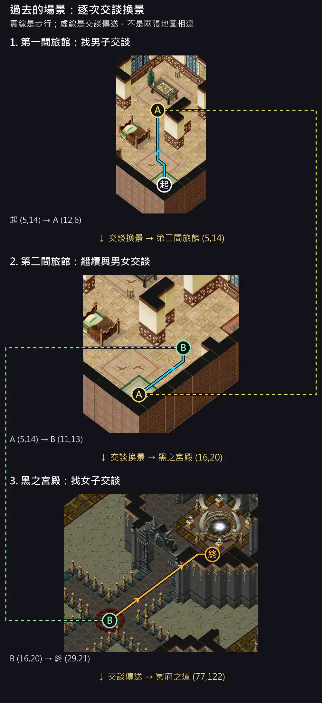</a>

<a href="/img/pages/任務攻略/魔力任務/盲目之龍/underworld.webp">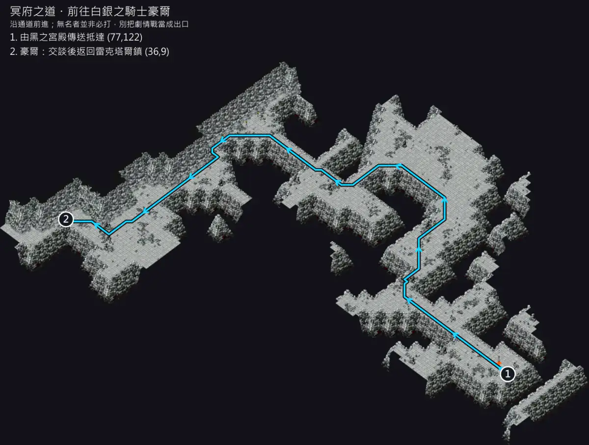</a>

**此時先不去岬之神殿**。帶著月心的特效藥，登出回哥拉爾補給，接著去第二趟麥尼村。

## 5. 第二次麥尼村：送藥、打實朝

再次從哥拉爾東門、橋頭前往麥尼村。進月心民家 `(65,54)` 交出第二份特效藥，再找小麥入洞。走到上次月心所在的 `(40,39)`，進入地下 1～16 樓隨機迷宮，最後到最下層找實朝 `(57,60)`。

**實朝 Lv84 ×1，血量約 13,700～13,900**。明鏡止水補很多，集中火力、維持輸出壓過回血；中混亂要及早處理。

戰後每人與實朝交談，取得**天帝之証**並傳回民家，**再找月心交談**，才回雷村。

展開麥尼村、第二次入洞與實朝地圖

<a href="/img/pages/任務攻略/魔力任務/三等勳章/43900.webp">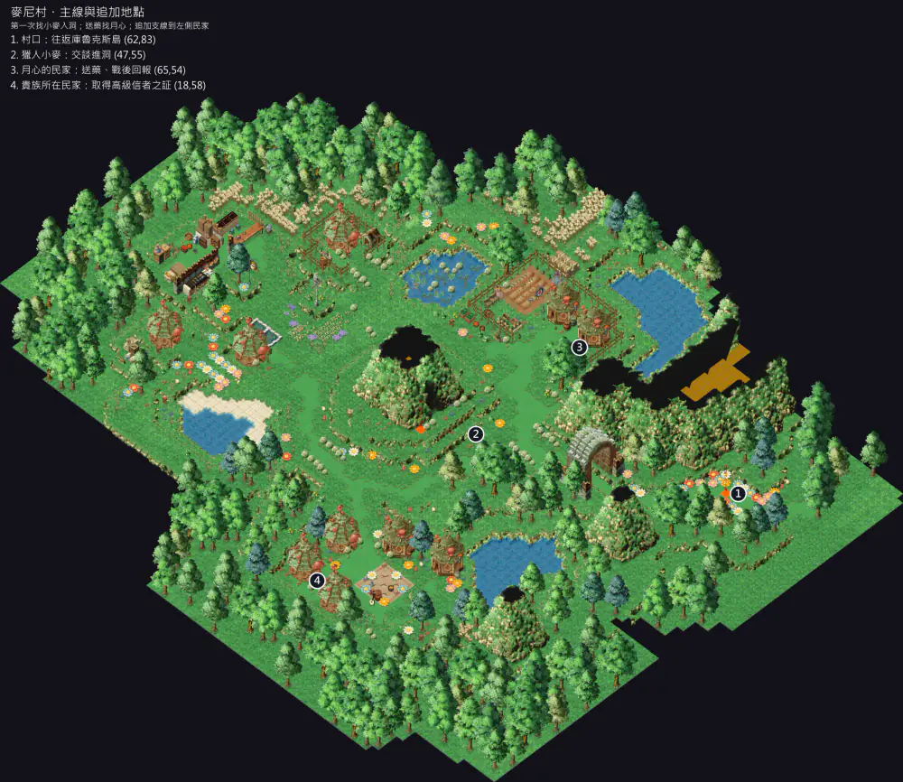</a>

<a href="/img/pages/任務攻略/魔力任務/三等勳章/43981.webp">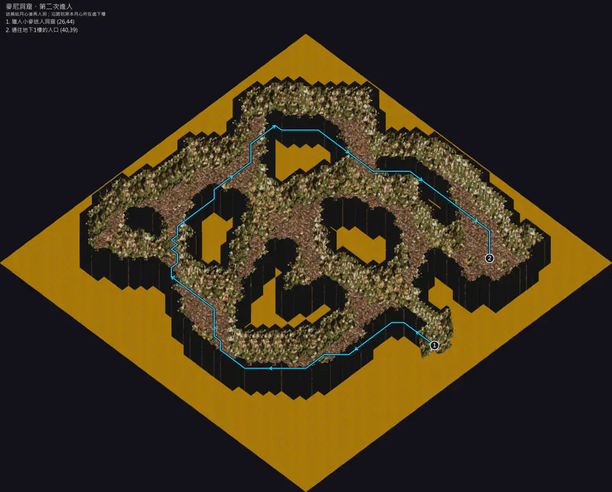</a>

<a href="/img/pages/任務攻略/魔力任務/三等勳章/43982.webp">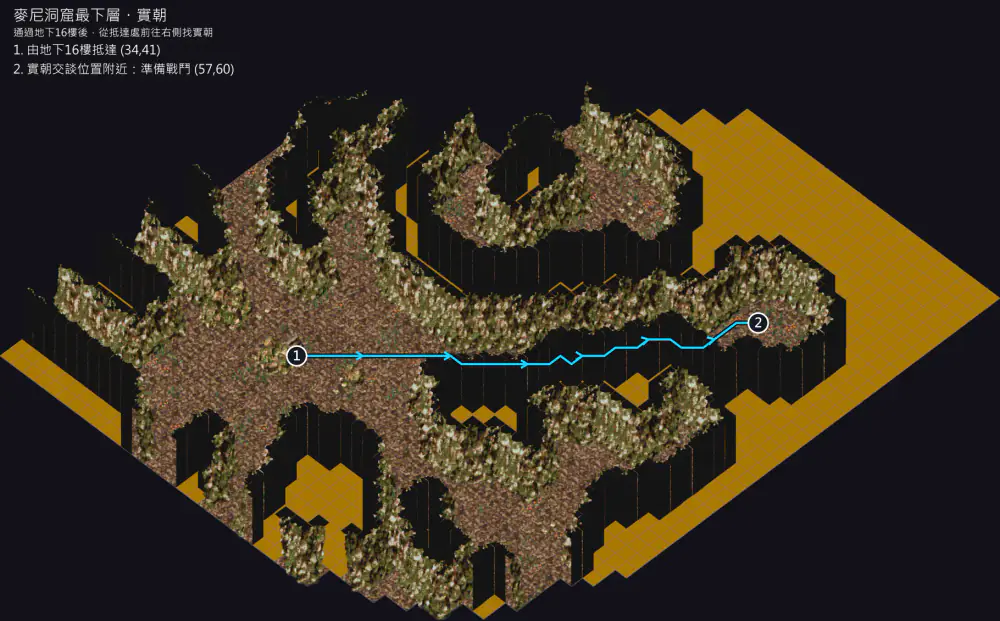</a>

## 6. 第三次雷村：打森國、領三勳

登出回哥拉爾，傳米村、步行雷村。神殿找護士進病房，與森國 `(9,7)` 交談開戰。

**森國 Lv82 ×1，血量約 13,200～13,400**。同樣會用明鏡止水大量回血，集中火力打倒。

戰後**解散隊伍，每人各自與席琳交談**，交出天帝之証，領取對應國別的第三等勳章。不要組隊一起交，避免只有一人領到、其他人一起被傳走。

展開森國與席琳位置圖

<a href="/img/pages/任務攻略/魔力任務/三等勳章/43772.webp">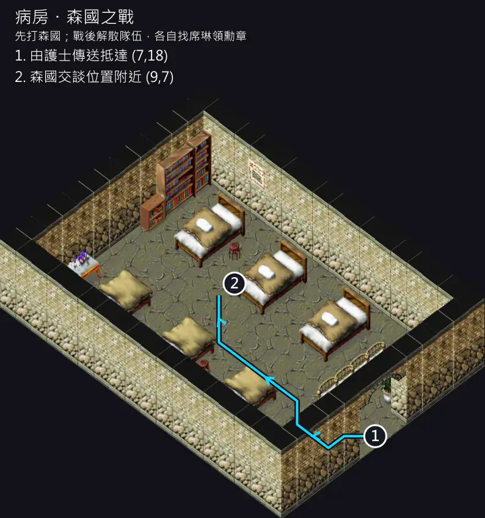</a>

<a href="/img/pages/任務攻略/魔力任務/三等勳章/43773.webp">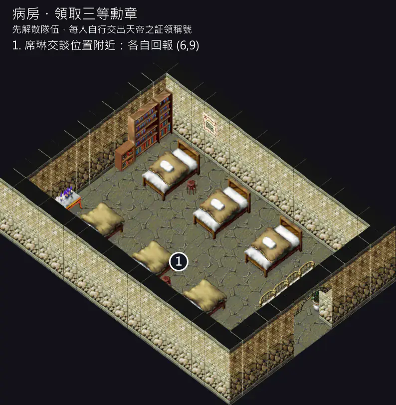</a>

## 7. 岬之神殿：完成盲龍

雷村醫院補給後，從南門出鎮，沿島上道路前往岬之神殿 `(832,688)`；庭院內走到建築入口 `(125,87)`。找薇絲 `(37,18)`，有通行許可證可直接通過，沒有則戰勝她後進地下1階。

依下圖走地下1～4階與最下層，找艾汀 `(22,14)`。每人交出**紅龍諾利的鱗片**，取得**北國行者、巨龍艾汀的鱗片、棉花糖串**，完成對話離開。艾汀這一步是交談領獎，不是頭目戰；巨龍艾汀的鱗片留給失翼之龍。

展開岬之神殿入口、薇絲與地下連續地圖

<a href="/img/pages/任務攻略/魔力任務/盲目之龍/cape-outside.webp">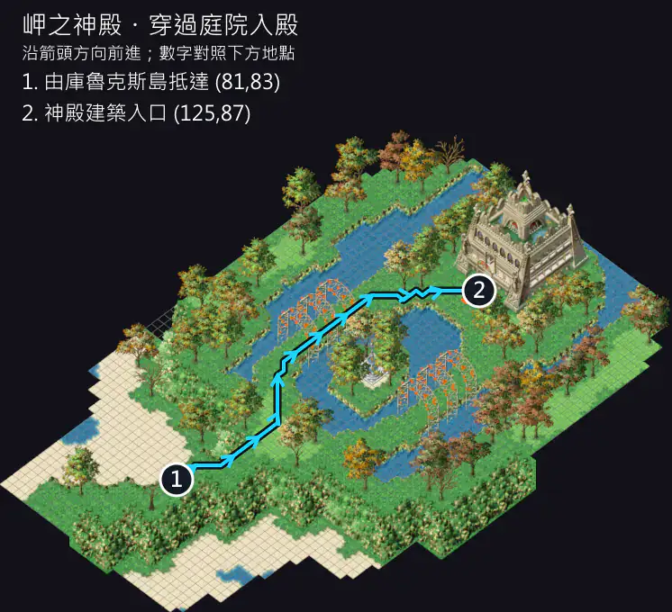</a>

<a href="/img/pages/任務攻略/魔力任務/盲目之龍/cape-guard.webp">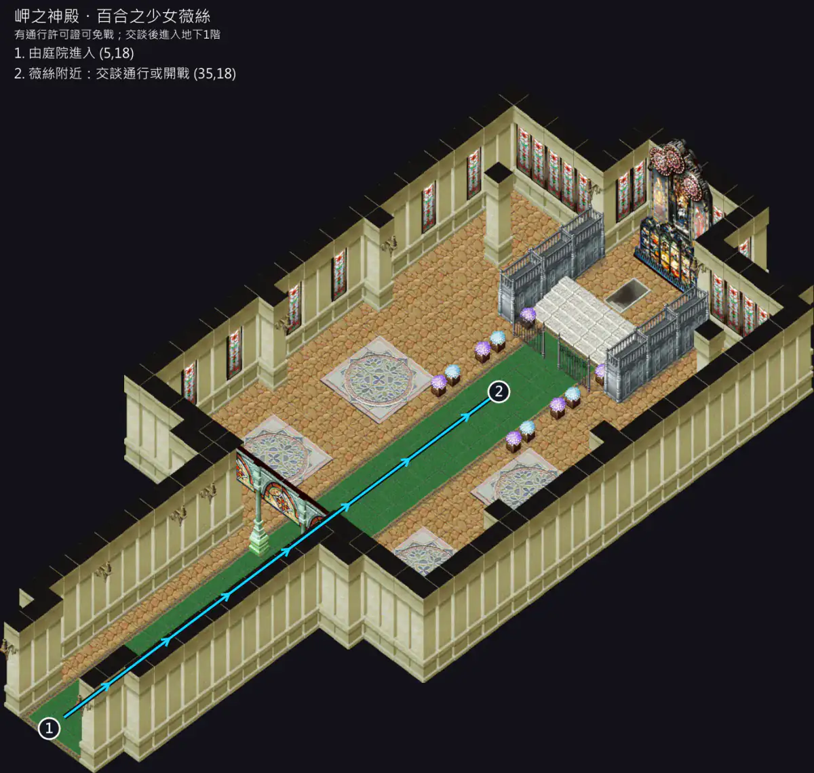</a>

<a href="/img/pages/任務攻略/魔力任務/盲目之龍/cape-upper-linked.webp">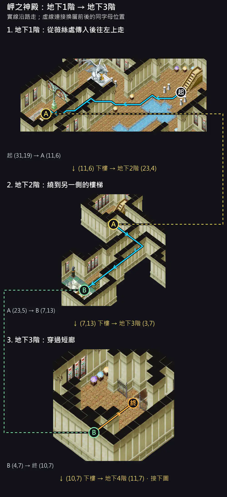</a>

<a href="/img/pages/任務攻略/魔力任務/盲目之龍/cape-lower-linked.webp">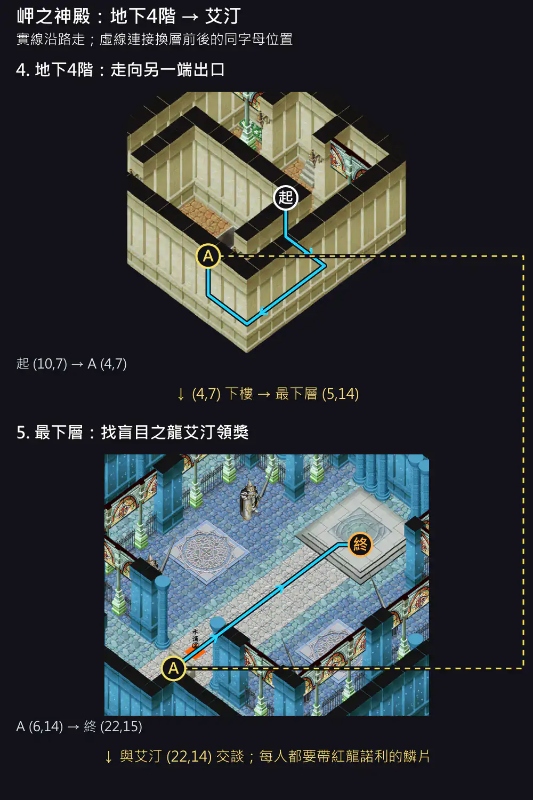</a>

## 三追要不要一起排？

**第一次解三龍系列，先不排三追。**三勳主線完成不等於三追完成；三追還要後續[失翼之龍](/任務攻略/魔力任務/失翼之龍)取得的**沙漏的碎片**。

已持有沙漏的碎片者，可在第6步領完三勳後，留在雷村再找護士、醫師接追加，再另跑麥尼村貴族與過去森林。森林入口只在**清晨或黃昏**開放，詳見[三等勳章的追加支線](/任務攻略/魔力任務/三等勳章#追加支線三追)；不必為等時段卡住盲龍最後一段。

## 路線依據

本篇將本站兩篇完整攻略重新排列；實朝與森國血量沿用各自攻略的初心戰鬥紀錄。任務條件與交付順序對照[蔚藍幻境－盲目之龍](https://cg.skyey.tw/errand/mdad01.htm)、[天帝之証](https://cg.skyey.tw/errand/mdad02.htm)及[御劍軒－盲目之龍](https://cgsword.com/Mission511.htm)。
